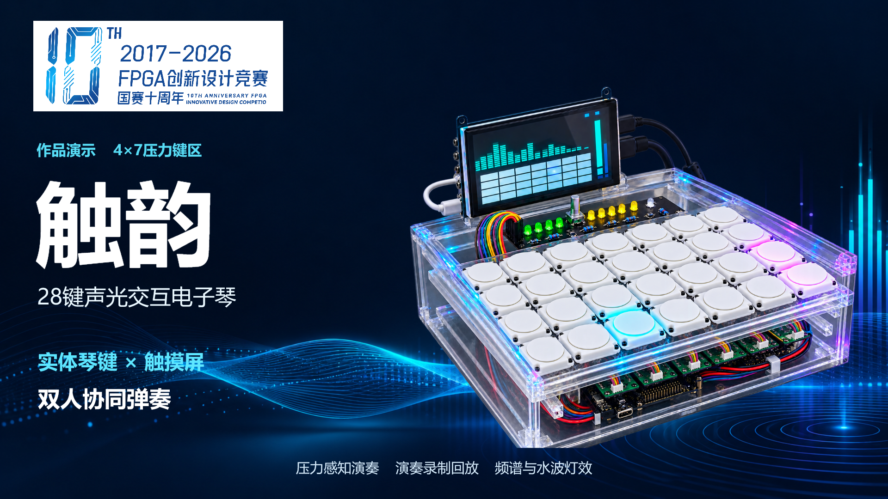
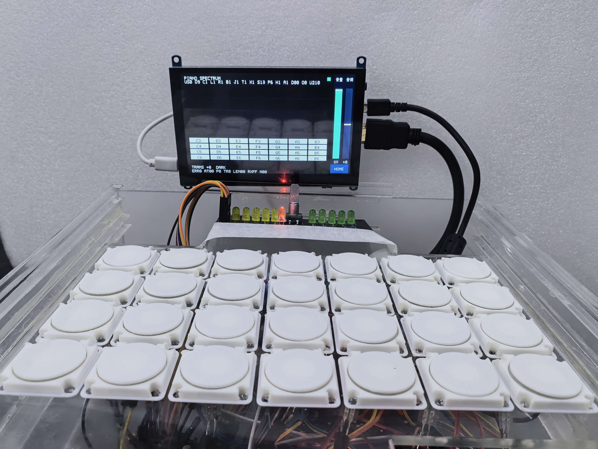
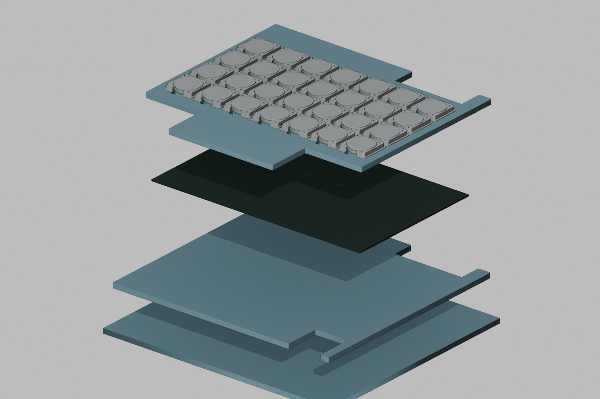

# 触韵 CHUYUN

**28 键声光交互电子琴 · 硬件设计、机械装配与 D12 FPGA 工程**



触韵以 Tang Mega 60K FPGA 和 NEO DOCK 为主控平台，采用 **4 行 × 7 列，共 28 键**的压力感知布局。实体琴键与触摸屏支持协同演奏，按压力度用于控制音量，演奏过程通过声音、屏幕频谱和水波扩散灯效呈现。

**压力感知演奏 · 双人协同弹奏 · 声光同步交互**

[在线录音工作室](https://proud-leaf-166f.2272419355.workers.dev/) · [机械装配](docs/assembly.md) · [电路与接线](docs/wiring.md) · [硬件图文说明](docs/hardware.md) · [完整技术文档](docs/technical-report.docx) · [D12 工程入口](fpga/README.md) · [软件功能与实拍](docs/software.md)

## 项目功能

- 28 键压力感知演奏，力度与音量联动。
- 实体琴键和触摸屏双人协同弹奏。
- 五种合成音色、28 声部，48 kHz / 16 位 PCM 输出。
- 最长 5 分钟 WAV 演奏录音与文件回放。
- CSV 谱面练习/挑战模式与灯光指引。
- CH569 USB 磁盘模式，实现 SD 文件双向复制。
- 屏幕频谱可视化、琴键触发水波扩散灯效。
- 通过控制板和触摸屏调节音量、音高和音色，并显示对应状态。

本仓库以硬件工程、机械文件及装配资料为主，附上项目提供的 D12 FPGA、软核与 CH569 配套工程。PCB 设计和电路图文资料由**小谢（Fish-0319）**完成，按提供的工程导出归档；FPGA 应用工程和录音工作室由项目对应成员维护，D13 尚在开发，本包以 D12 为版本依据。网站以以上链接访问，网页源码及域名部署配置不在本仓库内。

## 硬件组成

|部分|实现|
|---|---|
|主控|Tang Mega 60K + NEO DOCK|
|压力输入|28 个 FSR，四块同型采集板，每板接 7 路|
|采集转换|MCP3008，使用 CH0～CH6，SPI 输出|
|操作与指示|EC11 编码器、独立按键、5 绿 + 5 黄 + 1 状态灯|
|灯光板|4×7 键位、一键四灯，当前工程共 112 颗 RGB LED|
|显示交互|微雪 5inch HDMI LCD (H)，800×480；HDMI 图像与 USB Touch 独立通路|
|机械结构|七片亚克力、内侧 U 形导轨、独立圆形按压组件；灯光 PCB 直接由中层滑轨承托|

## 从哪里开始

1. 阅读 [硬件图文说明](docs/hardware.md)，了解总体、各板及按键结构。
2. 打开 `hardware/electronics/` 中的三个 `.epro2` 工程。压力采集与 Control 的有效布局是 **PCB2**，灯板为 **PCB1**。
3. 使用 `hardware/mechanical/cad/` 的七份毫米 DXF 查看亚克力切割轮廓；使用 `hardware/mechanical/stl/` 的两种 STL 查看打印件。
4. 用 Blender 打开 `hardware/mechanical/blender/`，结合 [装配说明](docs/assembly.md) 查看层级关系。
5. 按 [D12 工程入口](fpga/README.md) 打开 Gowin 工程，配合 [接线说明](docs/wiring.md) 核对封装球位，并登记 [28键通道映射表](docs/key-channel-map.csv)。

## 目录

```text
chuyun-hardware/
├── README.md
├── hardware/
│   ├── electronics/
│   │   ├── pressure/       七路采集板工程、原理图、PCB图
│   │   ├── control/        操作指示板工程、原理图、PCB图
│   │   └── lighting/       112灯工程、原理图、PCB图
│   └── mechanical/
│       ├── cad/            七片亚克力DXF及几何轮廓
│       ├── stl/            定位座与圆形传力托盘，各28件
│       └── blender/        整机与单键可编辑模型
├── fpga/
│   ├── README.md           D12工程入口与复现说明
│   └── d12/                原始D12源码、约束、ROM、固件及验证记录
├── docs/
│   ├── hardware.md         总体到局部的硬件说明
│   ├── assembly.md         装配顺序、关键方向与配合
│   ├── wiring.md           板端接口定义
│   ├── parts-list.csv      系统级物料清单
│   ├── key-channel-map.csv 实物键位与采集通道登记表
│   ├── design-status.md    文件适用范围和待补信息
│   ├── software.md         D12功能与六张软件实拍
│   ├── technical-report.docx
│   └── figures/            电路标注图及可编辑SVG
├── assets/
│   ├── photos/             实物照片
│   └── renders/            CAD预览、Blender渲染
└── verification/          文件清单、SHA-256及文件检查记录
```

## 实物与结构





渲染图用于说明结构关系；加工轮廓以 DXF 为准，现物装配及配合记录见 [机械装配](docs/assembly.md)。CAD 标称尺寸与装配后实测尺寸分别记录，图中的示意层高不能当作现物测量结果。

## 资料状态


D12 目录包含已发布 FPGA 位流、CH569 HEX、源码和验证记录。Gerber、贴片生产 BOM 及实板专项测量仍按 [资料状态](docs/design-status.md) 登记。代码与历史数字验证记录不替代整机实测。

## 贡献与资料使用

|成员|主要贡献|
|---|---|
|[xuanxly](https://github.com/xuanxly)|机械结构、按键组件、装配与实物记录，技术文档及项目资料整理|
|[Fish-0319](https://github.com/Fish-0319)|PCB设计、电路原理图、PCB工程与电路图文材料|
|maru|FPGA应用开发、录音工作室与网站部署维护|

本仓库尚未指定开源许可证。比赛标识、厂家资料和第三方器件资料的权利归各自权利人；厂家资料以 [官方参考链接](docs/references.md) 查阅。
