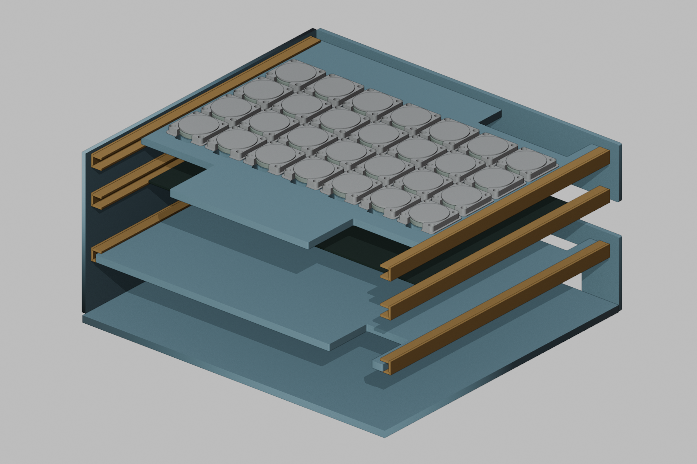
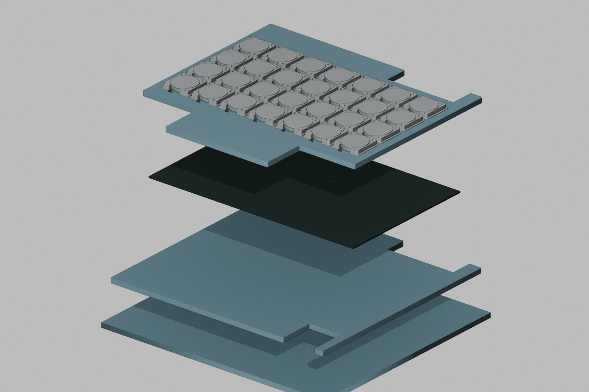
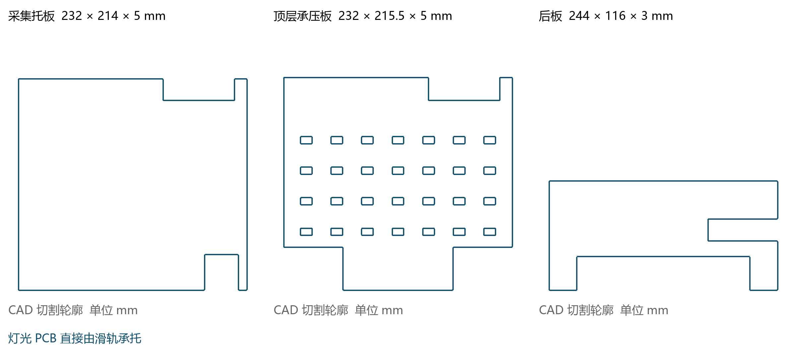
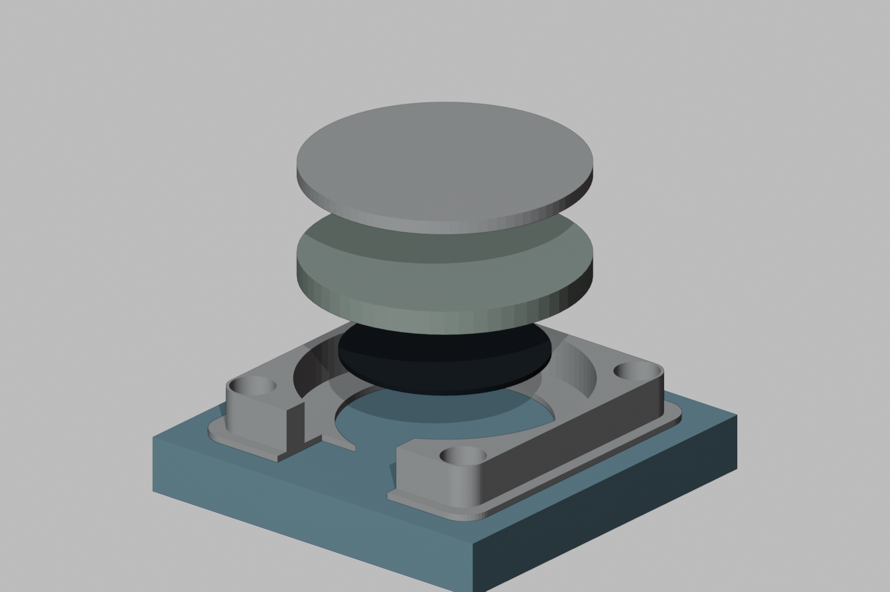
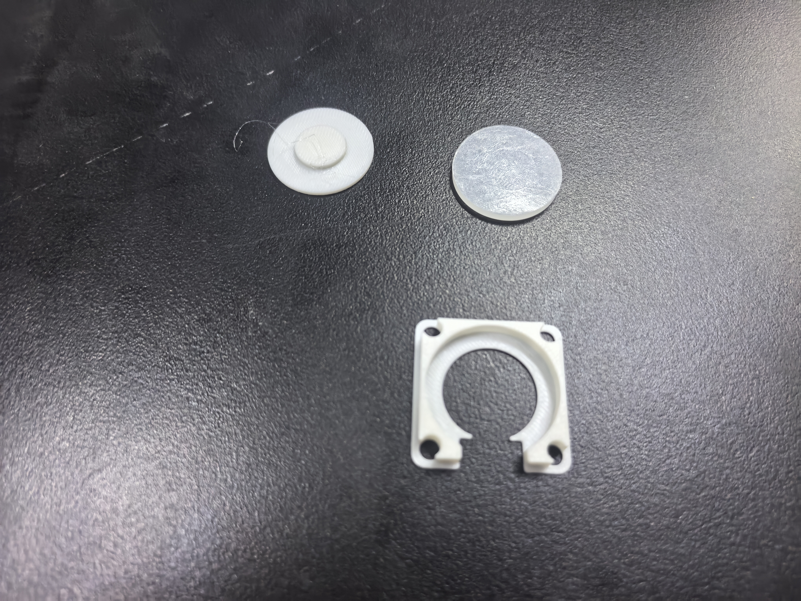

# 机械结构与装配

[返回项目首页](../README.md)

## 总体结构

外壳由底板、前板、左右侧板、后板、采集托板和顶层承压板七片亚克力组成。侧板粘接在底板外侧，U 形导轨固定于侧板内侧。内部按下层主控与采集电路、中层灯光 PCB、上层压力键区分层布置，预留软尾、线束及外设线缆的通道。

灯光 PCB 直接卡入中层滑轨，由滑轨承托。图中 PCB 厚度和层高用于结构示意，配合尺寸按实际 PCB、导轨和加工后的板件检查。

## 七片亚克力

文件单位为毫米。表中尺寸为切割图的标称外廓和板厚。

|板件|尺寸 mm|数量|DXF|
|---|---|---:|---|
|底板|244×224×5|1|[base](../hardware/mechanical/cad/base_244x224_t5.dxf)|
|前板|244×111×3|1|[front](../hardware/mechanical/cad/front_244x111_t3.dxf)|
|左侧板|221×111×3|1|[left](../hardware/mechanical/cad/side_left_221x111_t3.dxf)|
|右侧板|221×111×3|1|[right](../hardware/mechanical/cad/side_right_221x111_t3.dxf)|
|后板|244×116×3|1|[rear](../hardware/mechanical/cad/rear_244x116_t3.dxf)|
|采集托板|232×214×5|1|[acquisition tray](../hardware/mechanical/cad/acquisition_tray_232x214_t5.dxf)|
|顶层承压板|232×215.5×5|1|[key support](../hardware/mechanical/cad/key_support_232x215p5_t5.dxf)|

CAD 包含板材外形和相应开口。侧板外贴方式及导轨间距会影响内部有效宽度，不能仅由表中板件尺寸推定实物整机外廓。整机外廓、两侧轨距及安装高度尚未形成实测记录。

## 导轨与层板配合

每段实际导轨裁切长度为 **210 mm**，安装于左右侧板内侧。装配时先对齐同一层左右导轨，保持平行，并在胶接前用实际板件检查承托和抽拉。

层板左右边缘覆盖热熔胶以增加有效宽度，与实际轨距配合。热熔胶位于层板边缘；抽拉时应检查边缘轮廓是否平整、线束是否受拉以及板件是否仍有足够的承托搭接。

## 单键结构

自上而下为：**圆形传力托盘 → 硅胶垫 → FSR 压力传感器 → 刚性承托**，固定定位座约束其周向位置。按下后由托盘向下传力，硅胶垫提供缓冲和回弹。

**托盘的大平整圆面朝上供手指按压，中央小凸台朝下接触硅胶垫。**

|部件|标称尺寸|数量|文件|
|---|---|---:|---|
|固定定位座|29.8×29.8×4.4 mm|28|[key-guide STL](../hardware/mechanical/stl/key_guide_29p8mm.stl)|
|圆形传力托盘|直径25 mm，总高约2.4 mm|28|[key-tray STL](../hardware/mechanical/stl/key_tray_25mm.stl)|
|硅胶垫|直径25 mm、厚约2 mm，按采购实物适配|28|外购|
|FSR压力传感器|与键面和软尾槽适配|28|外购|

STL 采用毫米数值。先打印一套定位座与托盘，配上实际硅胶垫和 FSR 试装，再打印其余件。托盘文件中的凸台方向是打印摆放方向，装入琴键时按上述大平面向上、小凸台向下的方向安装。硅胶垫与 FSR 为外购件，不进行3D打印。

## 装配顺序

1. 按七份 DXF 核对板件外廓、厚度与缺口，检查定位座和软尾穿口的对齐关系。
2. 底板、侧板、前后板先干装，侧板贴在底板外侧；确认线缆通道后固定外壳。
3. 将每层左右 U 形导轨对齐固定，逐层使用实际层板或 PCB 检查抽拉、搭接和定位。
4. 布置主控和四块采集板，按键区编号登记 FSR 与通道关系，预留软尾活动余量。
5. 灯光 PCB 直接装入中层滑轨，检查与顶层键位、出光位置及软尾通路的对应。
6. 在顶层承压板固定定位座，铺设 FSR，再放硅胶垫与圆形托盘；软尾沿对应开口向下引出。
7. 安装 Control 板和屏幕，整理跨层线束，确认各层可以抽拉维护。
8. 逐键检查回弹、卡滞、串扰和软尾拉扯，再按主控工程完成通道对应与功能联调。

现有模型按 CAD 轮廓和打印 STL 建立。主控、电子器件及线束简化展示，图中间距和层高不能作为新的实测或加工依据。
