# 硬件系统：总体到局部

[返回项目首页](../README.md) · [接线说明](wiring.md) · [装配说明](assembly.md)

电路工程与本页电路图文由小谢（Fish-0319）提供。文件按原有设计归档，原生工程位于 `hardware/electronics/`；PNG便于查看，SVG保留可编辑标注。

## 总体连接

28路FSR压力输入经四块七路采集板转换后送入FPGA。Control板提供编码器、独立按键与状态指示；FPGA连接灯光、屏幕及声音输出，形成演奏交互。

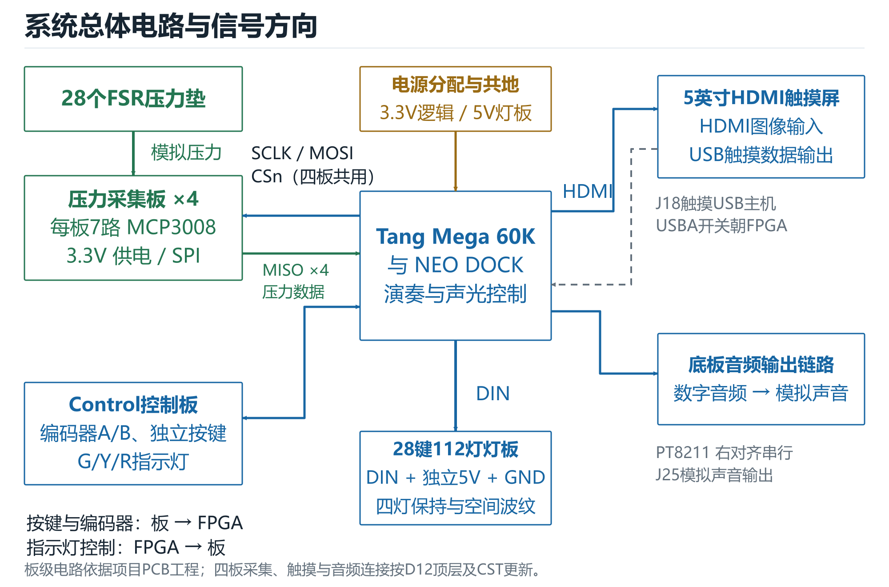

## 压力采集板

每板采用MCP3008的CH0～CH6七路，共四块。D12共用CS/SCLK/MOSI，四路MISO分别返回。每个FSR与10kΩ电阻构成分压，采样结果通过SPI输出。插座位号与空间键位的对应需要结合实物线束登记。

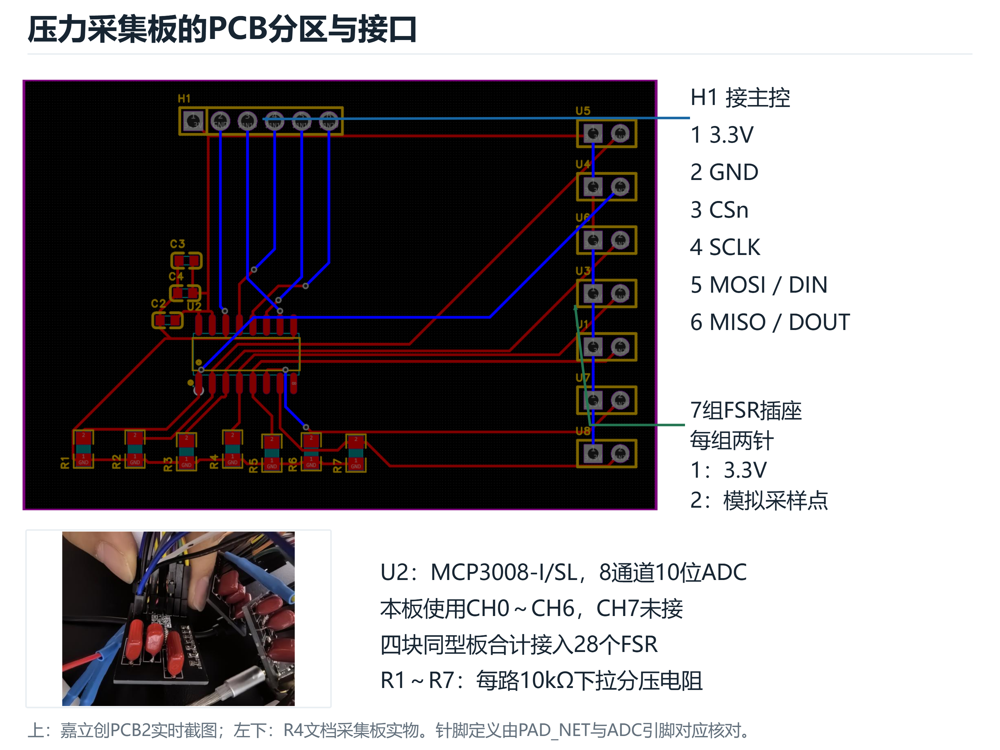

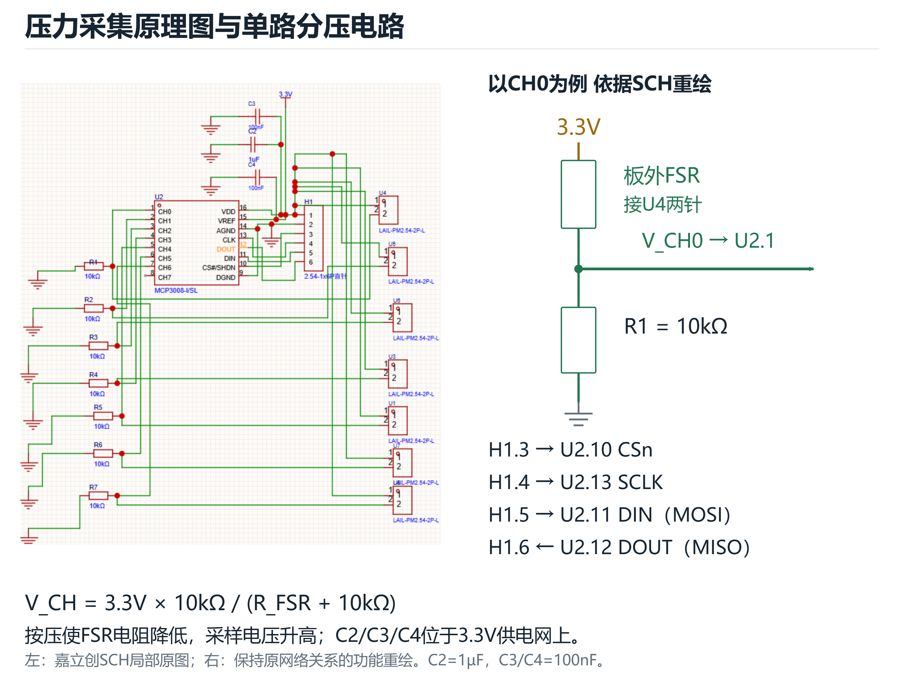

- [嘉立创EDA原生工程](../hardware/electronics/pressure/pressure.epro2)
- [完整原理图](../hardware/electronics/pressure/schematic.png)
- [PCB布局](../hardware/electronics/pressure/pcb.png)
- [原始网络记录](../hardware/electronics/pressure/netlist.json)

## Control操作指示板

长条PCB中部为银色编码器轴，两侧分别五颗绿色和五颗黄色指示灯，另有独立按键与状态灯。P1为16针供电及信号接口。D12用十路绿黄灯显示±5半音移调方向与档数，另一路灯表示当前明暗或揉弦开关。

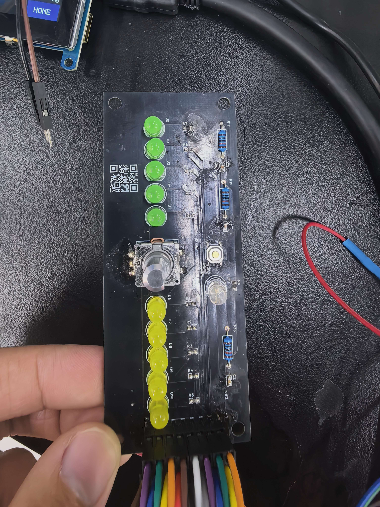

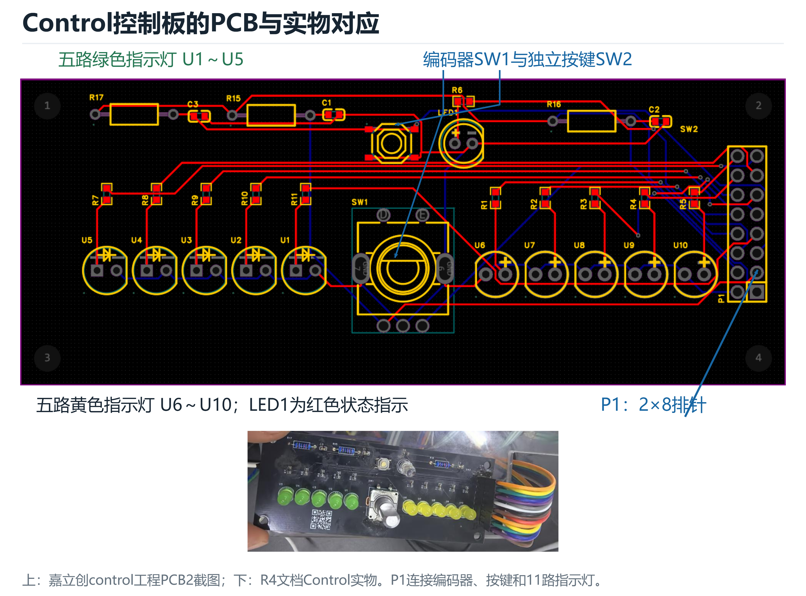

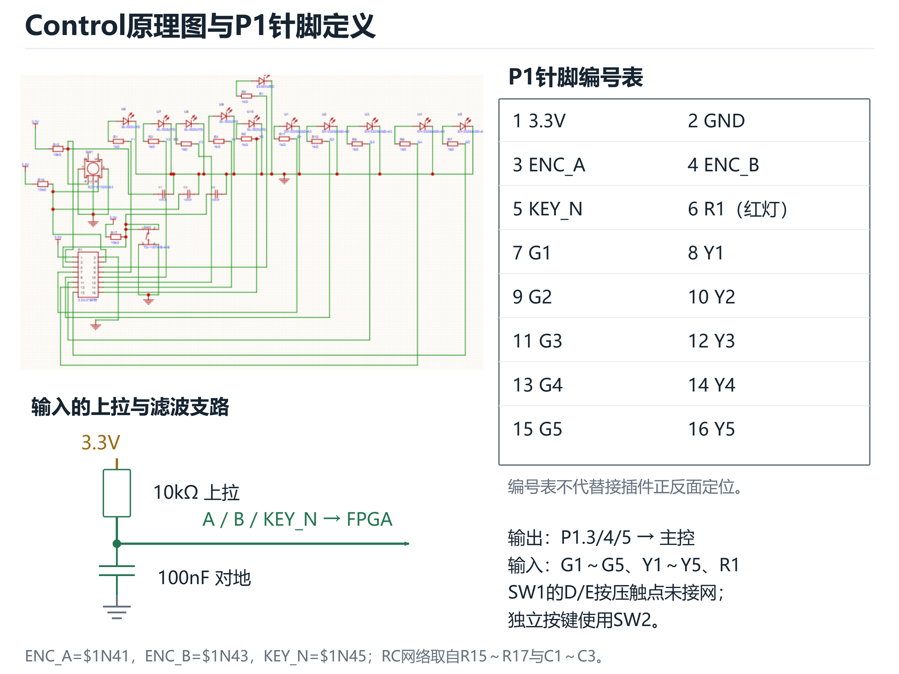

- [嘉立创EDA原生工程](../hardware/electronics/control/control.epro2)
- [完整原理图](../hardware/electronics/control/schematic.png)
- [PCB布局](../hardware/electronics/control/pcb.png)

## 一键四灯灯光PCB

当前电路工程采用4行7列28键，一键四颗RGB LED，共112颗。串行数据输入经缓冲和串联阻尼电阻送入灯链；板上保留FSR软尾开口。PCB直接由中层滑轨承托，灯效通过键位与串行地址对应实现。

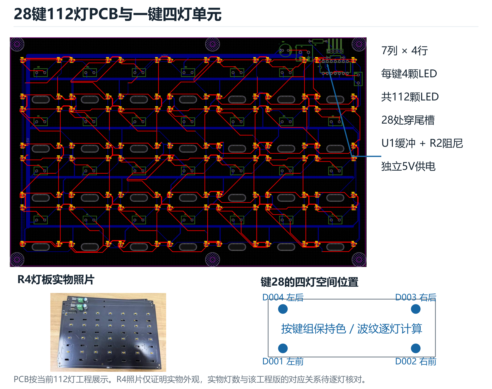

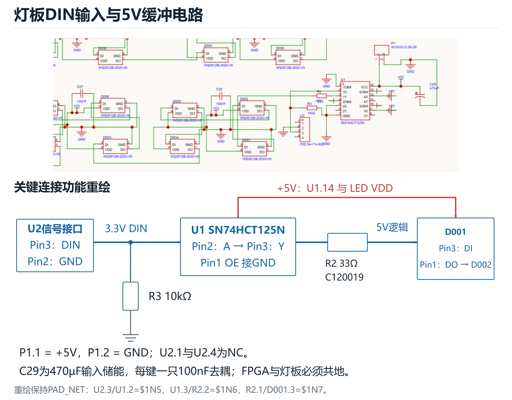

- [嘉立创EDA原生工程](../hardware/electronics/lighting/lighting.epro2)
- [完整原理图](../hardware/electronics/lighting/schematic.png)
- [PCB布局](../hardware/electronics/lighting/pcb.png)

照片记录原型装配；当前112灯工程与照片中的具体灯链排列对应见 [资料状态](design-status.md)。

## 跨层连接与外设

FSR软尾经键位开口引下，分别接入采集板。Control排线、灯板电源与数据线、主控外设线缆分层布置，并为抽拉维护保留余量。

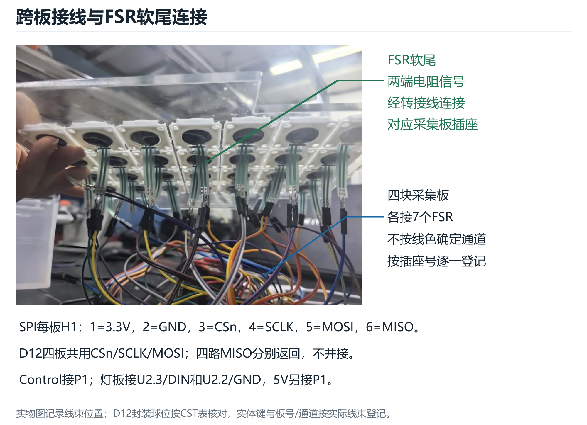

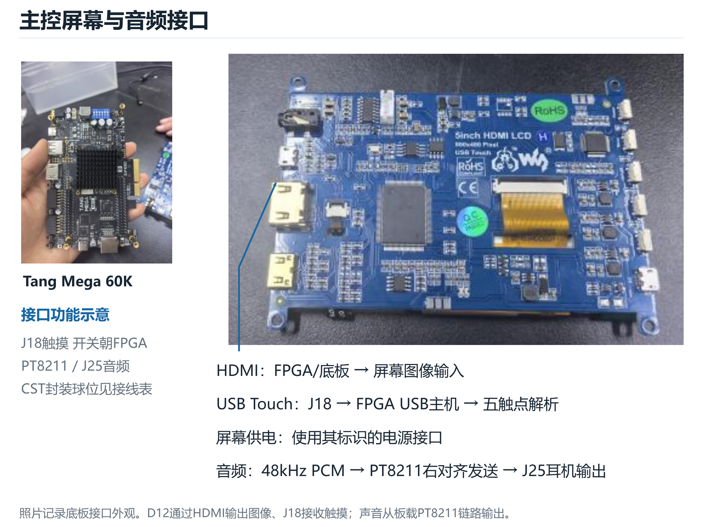

## 机械与按键

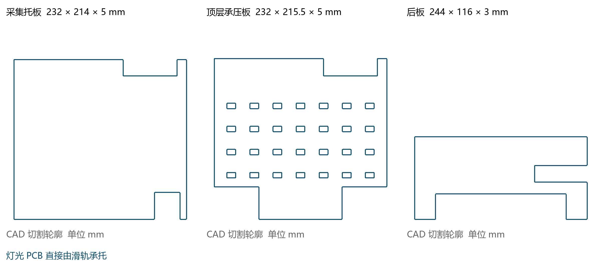

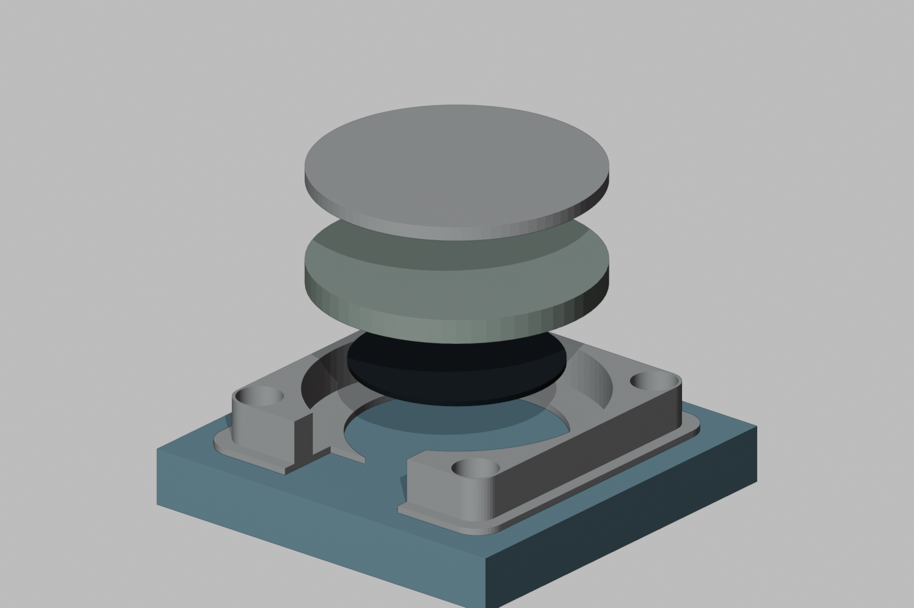

亚克力由七片独立板件组成。单键以平整圆形托盘作为按压面，下方依次为硅胶垫和FSR，周围固定定位座负责导向。具体尺寸、摆放方向与装配顺序见 [机械装配](assembly.md)。
