# D13 软件功能与实拍

[返回项目首页](../README.md) · [工程入口](../fpga/README.md) · [完整技术文档](technical-report.docx)

HDL承担实时压力处理、触摸解析、28声部五音色合成、FFT、画面、灯光及音游判定；VexRiscv软核负责FatFs、WAV录放、CSV装载和USB扇区服务。

|功能|D13实现|
|---|---|
|演奏|四行七列28键、最多五触点，同键力度合并，共用28声部|
|声音|五种音色，48 kHz / 16位PCM，±5半音、明暗或揉弦|
|效果器|混响、回声、合唱独立开关及 0～100% 强度，作用于实时琴声与录音|
|验证与音频扩展|VERIFY 数字监测及独立 32 路测试音；J13 标准 I²S|
|录放|最长5分钟单声道PCM WAV录音；16位PCM WAV回放|
|视觉|2048点FFT、32频段、800×480画面、112灯空间波纹|
|音游|CSV谱面，练习与挑战，和弦、长音及灯光引导|
|传输|CH569 USB MSC磁盘，SD卡与电脑双向文件复制|

HOME、VERIFY 与 EFFECTS 使用最新 D13 实拍，其余照片记录延续功能。参数来自 D13 代码，数字验证与专项实测分别列在技术文档中。

## HOME八个应用入口

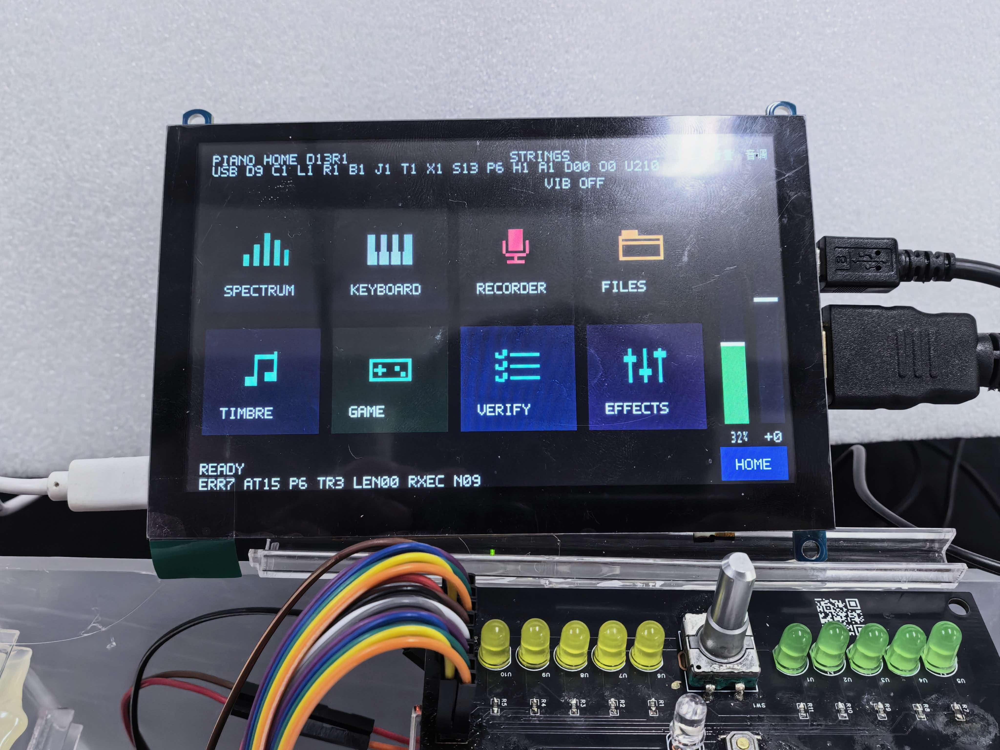

## 录音页、RECORD/PAUSE与4×7触屏键盘

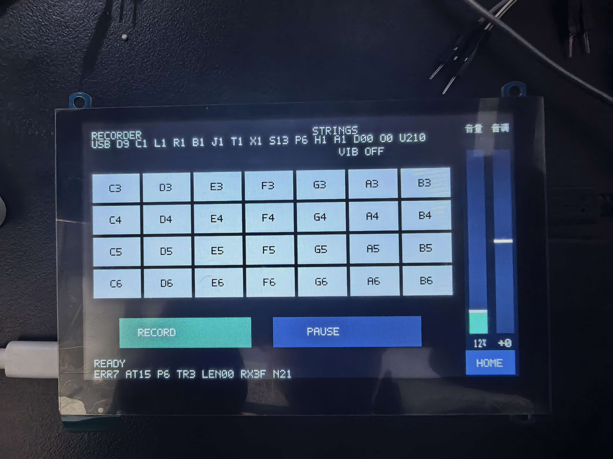

## 钢琴、电钢琴、风琴、吉他、弦乐五音色

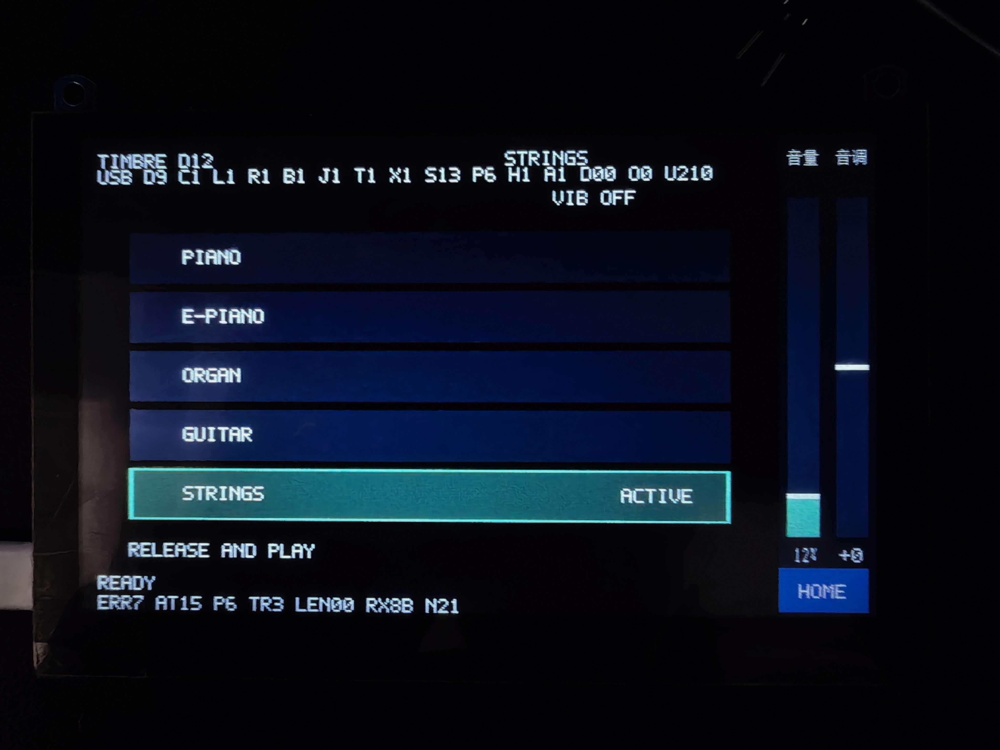

## 触摸演奏与32频段可视化

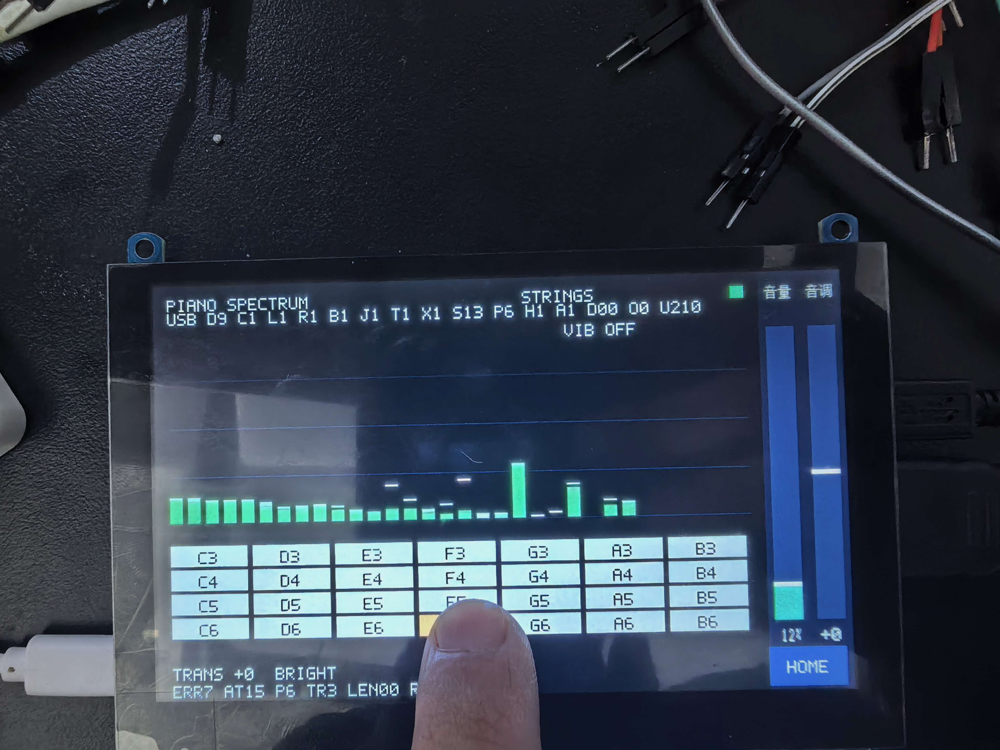

## TF卡目录浏览

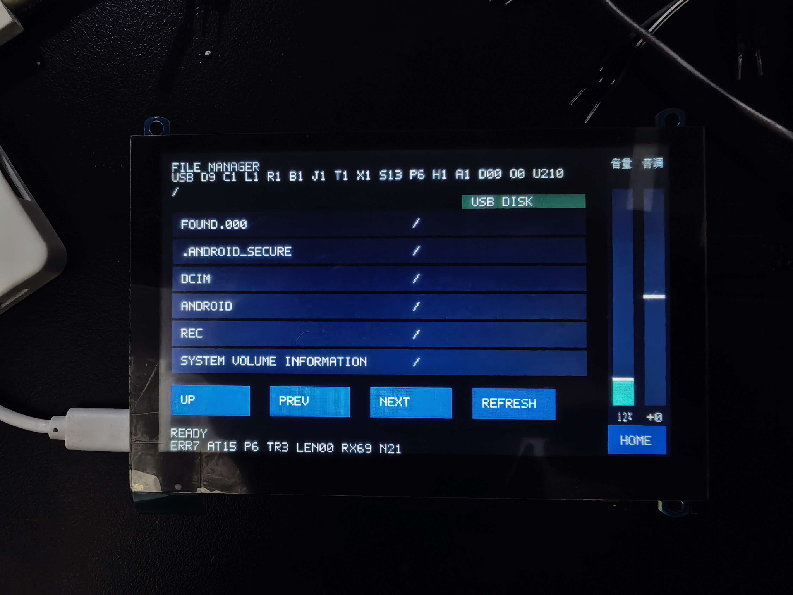

## CSV选曲、挑战模式与28键区域

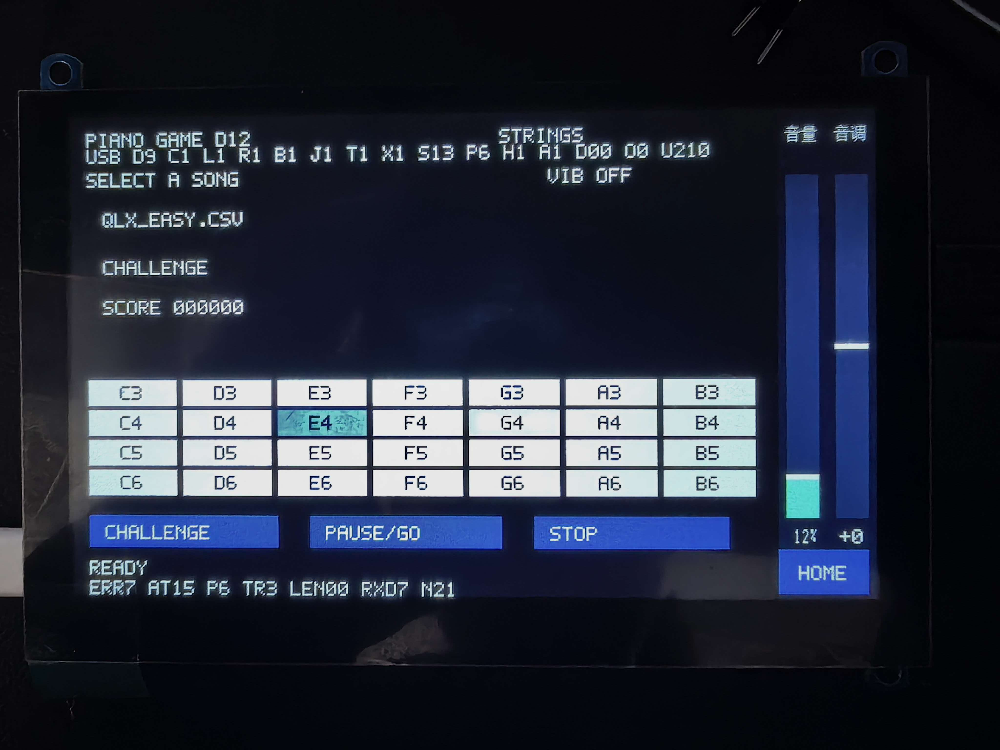

## VERIFY 数字状态监测

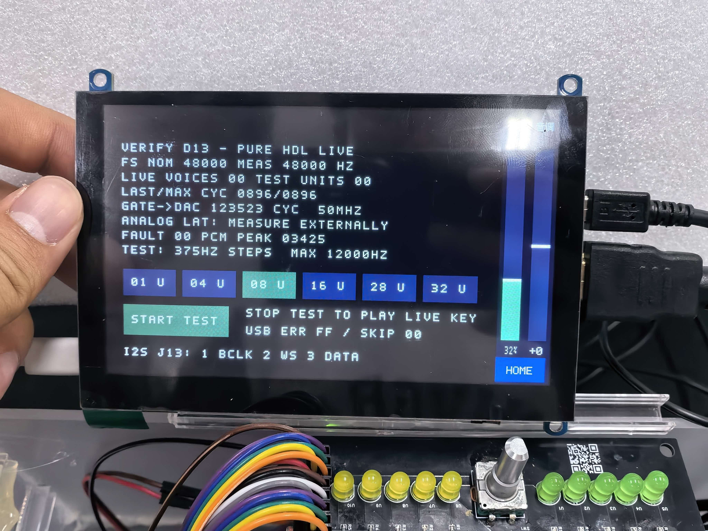

可主动启用 1/4/8/16/28/32 路测试音，观察采样计数、正常乐器引擎 LAST/MAX 周期、数字门控至 DAC 帧计数及峰值/故障状态。照片中的 `0896` 为正常 28 声部引擎周期；32 路测试引擎独立运行。本次照片的 `GATE→DAC` 为 123523 个 50 MHz 周期，约 2.47 ms，小于 5 ms；此值仅对应数字门控至 DAC 帧装载非零 PCM，模拟端到端延迟需另行测量。

## EFFECTS 三种硬件效果

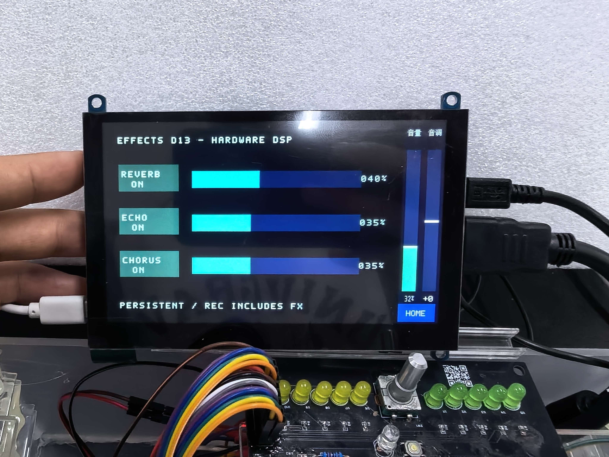

三种效果可同时打开，照片显示强度为 40%、35%、35%。页面切换保留本次运行的参数；录音捕获效果输出，监听音量不影响录音文件幅度。文件播放器沿独立通道回放。

## 软件流程与关键函数

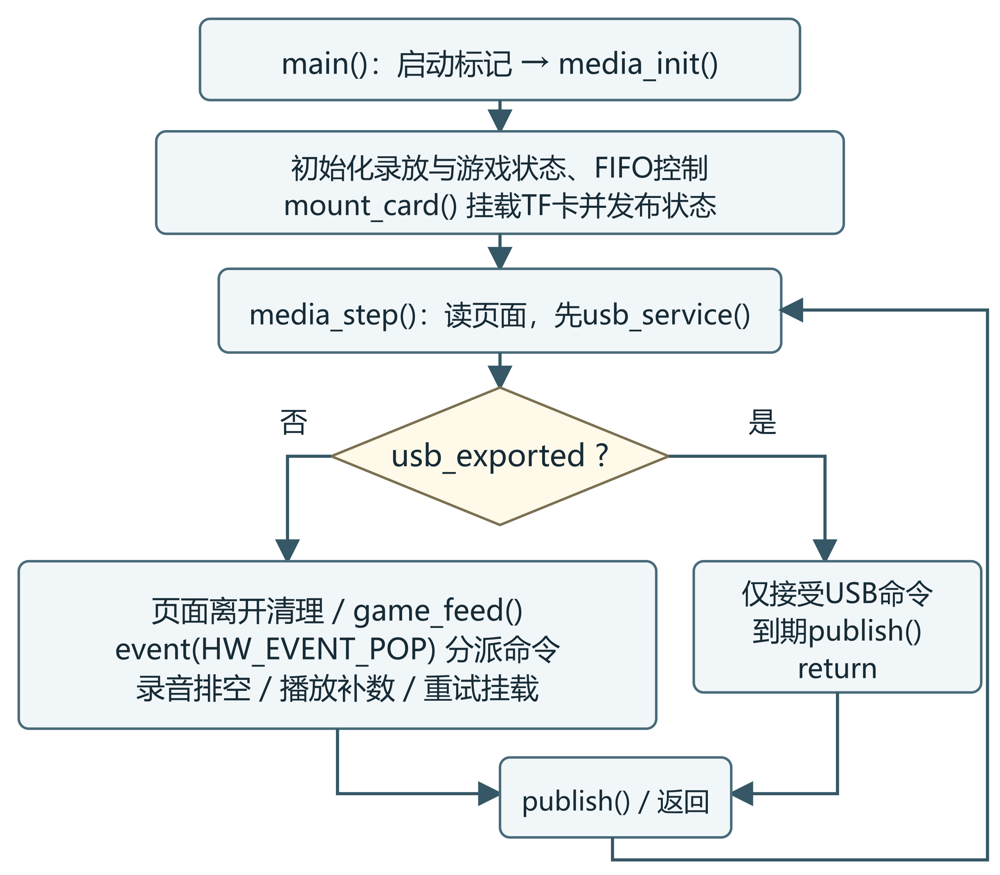

`main()` 初始化后循环执行 `media_step()`。每轮先处理 USB 协议；磁盘导出期间只接受磁盘命令，本地媒体访问停止。普通模式按页面状态调度录音排空、回放供数及谱面事件队列。

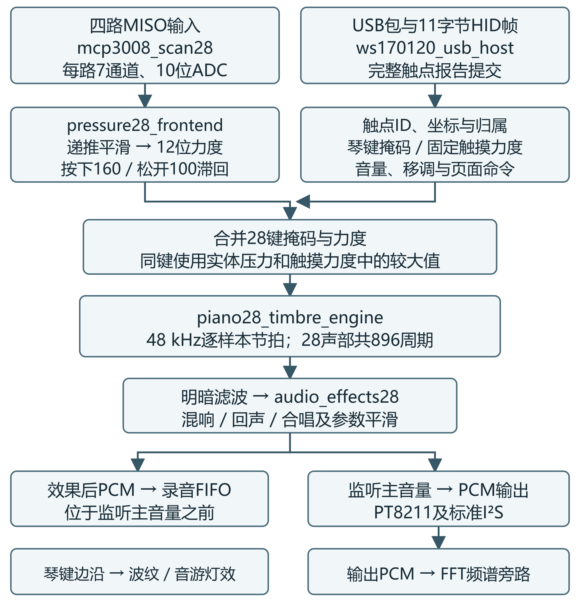

实体压力与触点状态合并后进入 28 声部合成。录音捕获效果器之后、监听主音量之前的 PCM，声音与频谱路径保持各自节拍。

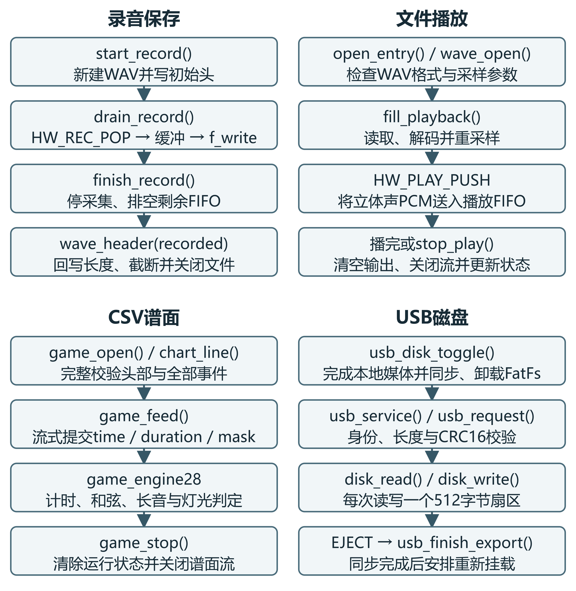

D13 录音保存到 TF 卡根目录，例如 `/REC0001.WAV`；`/SONGS/` 存放游戏 CSV。`REC` 目录是否存在取决于卡内目录内容，当前代码的录音写入路径为根目录。
