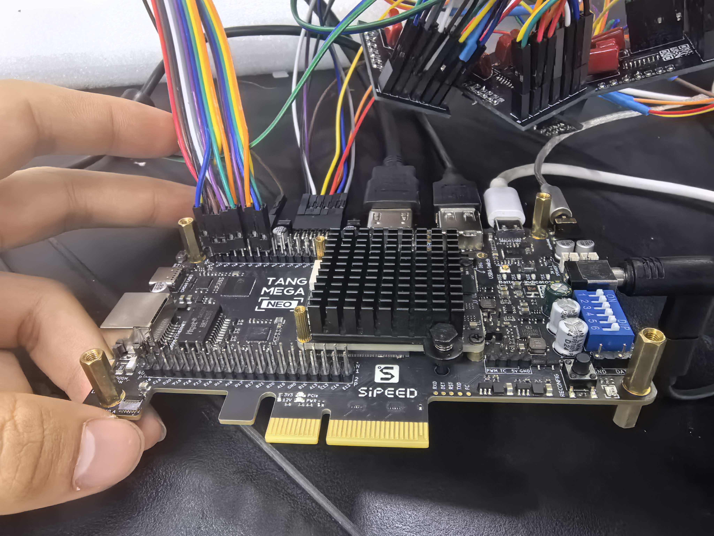

# 电路接口与接线

[返回项目首页](../README.md) · [总体图文](hardware.md)

以下板端连接来自项目原理图与网络记录。管脚均为**板端接口编号**，不是 FPGA 封装引脚。线色不作为针脚定义依据；排针方向以实物 1 脚标记为准。

## 七路压力采集板 ×4

每板采用 MCP3008，使用 CH0～CH6 七路；CH7 未接。FSR 接在 3.3 V 与采样节点之间，节点经10 kΩ下拉至GND，压力增大使采样电压上升。VDD/VREF为3.3 V；电源去耦与信号滤波用途按原理图区分。

|H1脚号|信号|方向|
|---:|---|---|
|1|3.3V|供电|
|2|GND|公共地|
|3|CSn|FPGA → ADC|
|4|SCLK|FPGA → ADC|
|5|MOSI / DIN|FPGA → ADC|
|6|MISO / DOUT|ADC → FPGA|

|ADC通道|FSR插座|10k下拉|ADC引脚|
|---|---|---|---:|
|CH0|U4|R1|1|
|CH1|U5|R2|2|
|CH2|U6|R3|3|
|CH3|U3|R4|4|
|CH4|U1|R5|5|
|CH5|U7|R6|6|
|CH6|U8|R7|7|

各FSR插座1脚为3.3V，2脚接采样节点。D13四块采集板共用CSn、SCLK和MOSI，四路MISO分别返回FPGA，不将四个DOUT并接。逻辑键号为7×板号+通道号，板号0～3、通道0～6。**不能直接假定“一行键对应一块板”或把插座位号作为空间顺序。** 使用 [键位映射CSV](key-channel-map.csv) 按实际线束登记。

## Control 板

P1为2×8排针，含EC11编码器A/B、独立按键及11路指示灯。绿灯五路、黄灯五路，另有一只透明外壳的状态灯；工程定义为红色指示灯。

|P1脚号|信号|相对FPGA方向|
|---:|---|---|
|1|3.3V|供电|
|2|GND|公共地|
|3|ENC_A|输入|
|4|ENC_B|输入|
|5|KEY_N|输入，独立按键按下拉低|
|6|R1，状态灯网络名|输出|
|7/8|G1 / Y1|输出|
|9/10|G2 / Y2|输出|
|11/12|G3 / Y3|输出|
|13/14|G4 / Y4|输出|
|15/16|G5 / Y5|输出|

编码器A/B和独立按键使用10kΩ上拉、100nF对地电容。指示灯串1kΩ限流电阻，主控相应输出置高点亮。编码器SW1的D/E按压触点在本工程中未接网，按键功能来自独立SW2。

## 一键四灯灯板

|接口|脚号|定义|
|---|---:|---|
|P1电源|1|+5V|
|P1电源|2|GND|
|U2信号|2|GND|
|U2信号|3|DIN|
|U2信号|1、4|未接|

DIN经SN74HCT125N第一通道缓冲，再串33Ω电阻进入D001的DI。输入端有10kΩ下拉。当前工程112颗RGB LED、28处FSR软尾开口，每键四灯；软件的空间灯效应依据键位坐标建立与串行地址的对应。

灯板使用独立5V供电，并与主控逻辑地共地。完整供电与去耦连接见原理图；输入针脚不能与电源接口混用。

## 屏幕及主控外设

微雪5inch HDMI LCD(H)以HDMI接收画面，以USB Touch回传触摸信息，供电按屏幕端口标识连接。HDMI和Touch是两条独立数据通路。D13由FPGA实现触摸USB主机，屏幕Touch连接NEO DOCK的J18，USBA-Switch朝FPGA；长按独立按键约2秒启动触摸会话。

D13以48 kHz / 16位LSBJ右对齐格式驱动板载PT8211，声音从J25耳机口输出。十路绿黄灯指示±5半音移调方向及档数，状态灯指示当前音色的明暗或揉弦开关。

照片用于记录器件与线束位置。复现时优先依据工程网络、接口1脚标识和主控约束核对连接。

## D13主要封装球位

以下为FPGA封装球位，板端H1/P1脚号见上文；完整约束以 [D13 CST](../fpga/d13/constraints/pressure_piano_touch.cst) 为准。

|信号|封装球位|
|---|---|
|时钟 / 复位|V22 / Y12|
|ADC CS / SCLK / MOSI|Y22 / Y21 / AB21|
|ADC MISO[0] / [1] / [2] / [3]|AB22 / AA20 / AA21 / AA19|
|编码器A / B / 独立按键|P17 / N17 / W21|
|状态灯|W22|
|移调灯[9:0]|V17、W17、T18、R18、R17、P16、U21、T21、R19、P19|
|PT8211 BCK / WS / DIN|Y17 / AB17 / AA16|
|功放控制 / 灯板DIN|AB16 / AB20|
|触摸USB D+ / D−|H13 / G13|
|TF MISO / SCK / CS / MOSI|AA15 / V15 / W15 / Y16|

CH569通过板内既有连线与FPGA作四位GPIO握手；USB磁盘与本地文件服务互斥占用SD卡。安装说明见 [原始D13说明](../fpga/d13/README_请先看.md)。

## J13 标准 I²S 扩展

J13 为靠 PCIe 的 SDRAM0 扩展排针，按板端 1 脚标记确定方向。

|信号|排针位置|FPGA 球位|
|---|---|---|
|BCLK|J13-1|E14|
|WS|J13-2|E13|
|DATA|J13-3|C15|
|GND|J13-12|公共地|

接口为 3.3 V 逻辑，48 kHz、16 位有效 PCM，左右各 32 位时隙，平均 BCLK 3.072 MHz。WS 切换后一位发 MSB；50 MHz 分数分频产生 20 ns 边沿量化。J13-11 的 5 V 不是音频信号。原有 PT8211/J25 输出继续使用。
